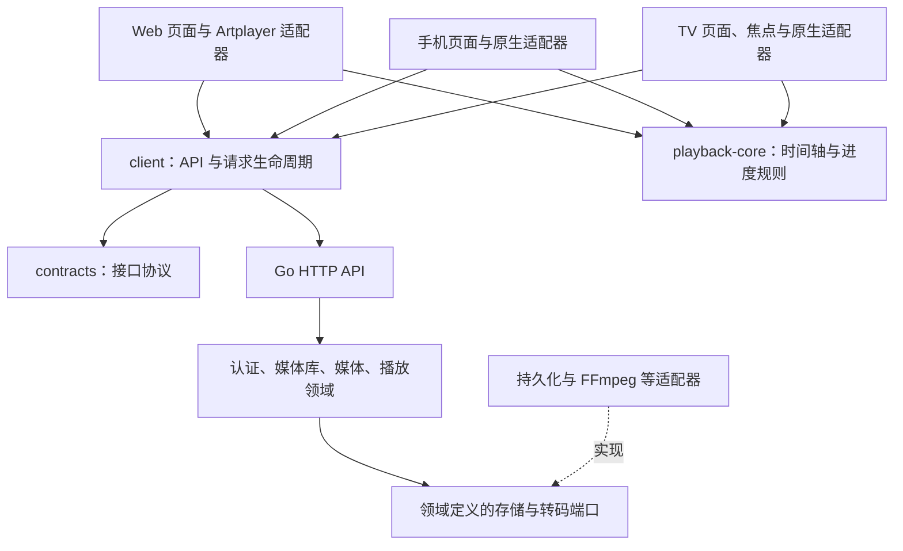

# 电视与手机 App 架构规划

状态：方案，尚未创建 App 工程或改变现有 API。

平台暂按 Android TV / Google TV，以及 Android / iOS 手机规划。Apple TV 可在电视端后续评估；三星 Tizen、LG webOS 需要独立方案，不能直接安装 Android TV 包。平台范围确认后更新本方案。

## 技术方向

继续使用一个 Go 服务提供媒体、认证、播放和进度 API。Web、手机、电视放在同一仓库，分别构建与发布。

| 客户端 | 建议方案 | 主要职责 |
| --- | --- | --- |
| Web | 现有 React + Vite + Artplayer | 浏览、播放及服务器管理 |
| 手机 | React Native + TypeScript；优先评估 Expo development build | 触摸浏览、播放、服务器与账户切换 |
| 电视 | 独立 React Native TV 工程，使用 react-native-tvos | 遥控器浏览、焦点恢复、大屏播放 |

手机和电视共用 TypeScript 业务代码，分别维护导航、布局和播放控件。现有 React DOM、CSS、React Router、Artplayer 不能直接用于原生界面。

React Native 的电视支持来自社区维护的 react-native-tvos。Expo 提供 TV 构建路径，但部分库不能用于电视。落地前先完成播放器和遥控器验证，再锁定兼容的 React Native、TV fork、Expo 与原生模块版本。手机和电视保留独立依赖解析，避免 TV fork 替换手机或 Web 使用的运行时。

## 建议目录

```text
dinosaur/
├── cmd/dinosaur/                 # Go 服务入口
├── internal/                    # 现有服务端领域与适配层
├── ui/                          # 现有 Web 工程，暂不迁移路径
├── web/dist/                    # Web 构建产物，由 Go embed
├── apps/
│   ├── mobile/
│   │   ├── src/
│   │   │   ├── app/             # 启动、导航、依赖组装
│   │   │   ├── features/        # servers/auth/home/catalog/details/player/settings
│   │   │   ├── components/      # 手机通用组件
│   │   │   └── adapters/        # 凭据存储、原生播放器、生命周期
│   │   ├── android/
│   │   └── ios/
│   └── tv/
│       ├── src/
│       │   ├── app/             # TV 启动、导航、依赖组装
│       │   ├── features/        # pairing/home/catalog/details/player/settings
│       │   ├── components/      # 海报行、焦点卡片、TV 弹层
│       │   ├── focus/           # 焦点定位、恢复与遥控器事件
│       │   └── adapters/        # TV 凭据存储与原生播放器
│       └── android/
├── packages/
│   ├── contracts/               # 从 API 契约生成的 DTO 和错误代码
│   ├── client/                  # 类型化 API、请求取消、服务器地址处理
│   ├── playback-core/           # 源时间轴、播放会话、进度提交规则
│   └── design-tokens/           # 颜色、间距、圆角等设计值
├── api/openapi.yaml             # 逐步覆盖已有及新增 API 的协议来源
├── scripts/                     # 构建、生成与检查入口
└── docs/client-app-architecture.md
```

这些是目标目录，按功能实施时创建。第一阶段只建立实际使用的包，避免空目录与空抽象。新增源码和测试继续遵守单文件 250 行；届时将 apps/、packages/ 加入行数检查脚本，排除生成文件和第三方依赖。

每个 feature 内按需拆分 screen、components、model 和 hooks；不要求每个功能创建全部子目录。认证、媒体库、媒体信息、播放各自维护边界。

## 共享代码的边界



领域定义存储、转码等端口，持久化和外部工具适配器实现这些端口；领域不导入 HTTP 或数据库实现。

- contracts 仅定义网络数据和错误，不导入客户端页面，也不直接照搬数据库表结构。
- client 按 auth、libraries、catalog、playback 拆分 API；通过注入 transport、认证提供器和服务器地址工作，不访问 window、DOM 或原生存储。
- playback-core 维护完整影片时间与分段流时间的换算、连续剧续播和同一播放会话内的进度提交顺序，不依赖 Artplayer、ExoPlayer 或 AVPlayer。
- 页面负责展示与交互；播放器、凭据存储、网络状态、系统返回键通过各端适配器接入。
- design-tokens 共享视觉值，各端独立实现组件；不共用一套同时处理触摸、鼠标和遥控器的页面。

先抽取 ui/src/lib/types.ts、错误代码和可独立使用的 API 方法。现有 ui/src/lib/api.ts 依赖 Cookie、window 事件及模块级会话，不能直接移到共享包。服务器与会话实例必须隔离；切换服务器或用户时取消旧请求、停止播放并清空对应缓存。

## 服务端需要补齐的能力

### 设备认证

目前服务端只接受 Cookie，写操作还要求 CSRF。手机和电视不能只在请求里添加 Bearer 就直接复用。

新增设备会话领域及存储适配：原生登录签发独立的随机不透明 Token，服务端仅存哈希，记录用户、设备、期限和撤销状态。第一版采用固定期限，过期重新认证；后续确有需要再加刷新机制。客户端通过系统安全存储保存凭据。退出撤销当前设备，修改密码或禁用账号撤销相关全部会话。

HTTP 认证适配器明确区分 Cookie 与设备 Token；Cookie 写操作继续验证 CSRF，设备 Token 只从 Authorization 读取。含多套认证信息的请求采用明确的拒绝策略。角色权限沿用现有领域规则。

电视增加设备配对：电视取得私有轮询凭据和短验证码，用户在已登录的 Web/手机确认设备，电视按服务端要求轮询领取设备会话。验证码一次有效、短时过期，配对与轮询限流；验证码本身不能读取设备 Token。第一阶段可先用账号密码验证完整播放链路，再实现配对。

建议领域目录为 internal/deviceauth/，数据库操作放 internal/store/ 对应适配文件，HTTP 转换及权限检查放 internal/server/。新增接口路径在 OpenAPI 中定义后实施，不假设当前已存在。

### 服务连接与 API 协议

- 提供最小服务器信息接口，返回服务标识、API 协议版本和功能能力，便于检测旧版服务器与不支持的功能。
- 现有 /api/ 路径保持兼容，新增字段和能力检测逐步演进；出现真正不兼容协议时再明确划分新版本。
- App 手动填写服务器地址作为首版连接方式，保存多个服务器；自动发现放后续阶段。
- 将返回的相对封面、视频和字幕 URL 解析到当前服务器；各资源请求都需要正确鉴权。跨域重定向不得携带设备凭据。
- 正式连接使用设备信任的 HTTPS 证书。NAS 当前站点沿用的证书须在目标设备上验证信任，App 不内置跳过证书校验的逻辑。

### 播放协商与进度

当前 internal/playback/plan.go 使用浏览器编码能力基线。Android 设备可能直接播放 MKV/HEVC，不能统一按浏览器能力转码。

客户端上报受限且经过校验的容器、编码、音轨、字幕和流协议能力；服务端结合源文件决定 direct、remux 或 transcode。客户端解码失败时可以请求兼容方案，限制自动重试次数。播放方案显式返回源时间偏移和流协议，避免各端猜测兼容流的时间轴。

原生播放器优先评估 react-native-video 的适配层：Android 使用 ExoPlayer，Apple 平台使用 AVPlayer。具体库版本需验证 TV 支持，不能仅根据手机示例推断。媒体容器可解析也不代表设备能硬件解码对应视频、HDR 或音频格式。

第一阶段验证现有 Range 原片流和兼容流在真机上的行为；如 AVPlayer 对现有兼容流存在限制，再在 internal/streaming/ 增加按需 HLS 适配。播放方案领域不直接依赖 FFmpeg 命令行。

现有进度接口可作为起点。同一设备按播放会话串行提交；暂停、跳转、退出和切后台触发提交。缓存按服务器和用户隔离。多设备同时播放的覆盖规则需明确为服务端接收顺序；如需拒绝迟到更新，再扩展播放会话 ID 与序号，不能用取最大进度代替，因为用户可能主动后退。

## 各端首版功能

| 手机 | 电视 |
| --- | --- |
| 服务器配置、登录、退出 | 服务器配置、设备配对、退出 |
| 首页与继续观看 | 海报横排首页与继续观看 |
| 电影/剧集列表、搜索、详情 | 遥控器列表、搜索、详情、选季选集 |
| 播放、跳转、音轨、字幕、续播 | 播放、快进快退、音轨、字幕、自动下一集 |
| 前后台切换与横竖屏播放 | 返回键、焦点恢复、播放控件自动隐藏 |

媒体库目录管理、扫描、刮削、磁盘设置继续集中在 Web。下载离线观看、投屏、后台播放、自动发现和 App 内服务器管理属于后续范围。

TV 焦点状态以页面、媒体 ID、海报行和滚动位置定位；从详情或播放返回时恢复到原卡片。弹层关闭恢复触发控件；分页、刷新或删除条目后提供可预测的回退焦点。首屏不可只做放大的手机网格。

## 实施顺序与交付条件

1. **播放与交互验证**：建立最小 Android TV 播放样例和手机样例；验证受保护的封面/视频/字幕、MP4、MKV/HEVC、兼容流、续播与跳转。TV 同时验证焦点、返回键和目标遥控器。确认平台、依赖组合及 iOS 是否需要 HLS。
2. **协议与公共包**：设备会话、服务器能力协议、播放能力协商；抽取 contracts、client 和确实共用的播放规则。同步迁移 Web 调用，保持旧客户端兼容。
3. **手机首版**：连服务器到续播的完整流程、电影与剧集、账户隔离、音轨字幕和生命周期。
4. **电视首版**：设备配对、大屏浏览、焦点恢复与遥控播放；以真实电视/盒子验收。
5. **发布**：签名 Android 手机 APK 与 Android TV APK，分别标记产物；需要 iOS 时使用 macOS/Xcode 构建与签名。记录客户端与最低服务端协议兼容范围。

Go 的 build.sh 继续负责 Web + Go 二进制。App 使用各自构建入口和独立流水线，按目录变化触发；不让 NAS 服务打包依赖 Android SDK、Xcode 或 App 签名。源码、锁文件和必要原生工程配置入 Git，依赖缓存、签名私钥、APK/AAB/IPA 与生成产物放构建产物或 Release。

## 参考

- [React Native：社区平台与电视支持](https://reactnative.dev/docs/out-of-tree-platforms)
- [Expo：电视 App 构建及限制](https://docs.expo.dev/guides/building-for-tv/)
- [React Native TV：平台工程与焦点能力](https://github.com/react-native-tvos/react-native-tvos)
- [React Native Video：原生播放后端](https://docs.thewidlarzgroup.com/react-native-video/docs/v6/intro/)
- [Android Media3：容器与编码支持](https://developer.android.com/media/media3/exoplayer/supported-formats)
- [Apple AVPlayer：文件与 HLS 播放](https://developer.apple.com/documentation/avfoundation/avplayer)
